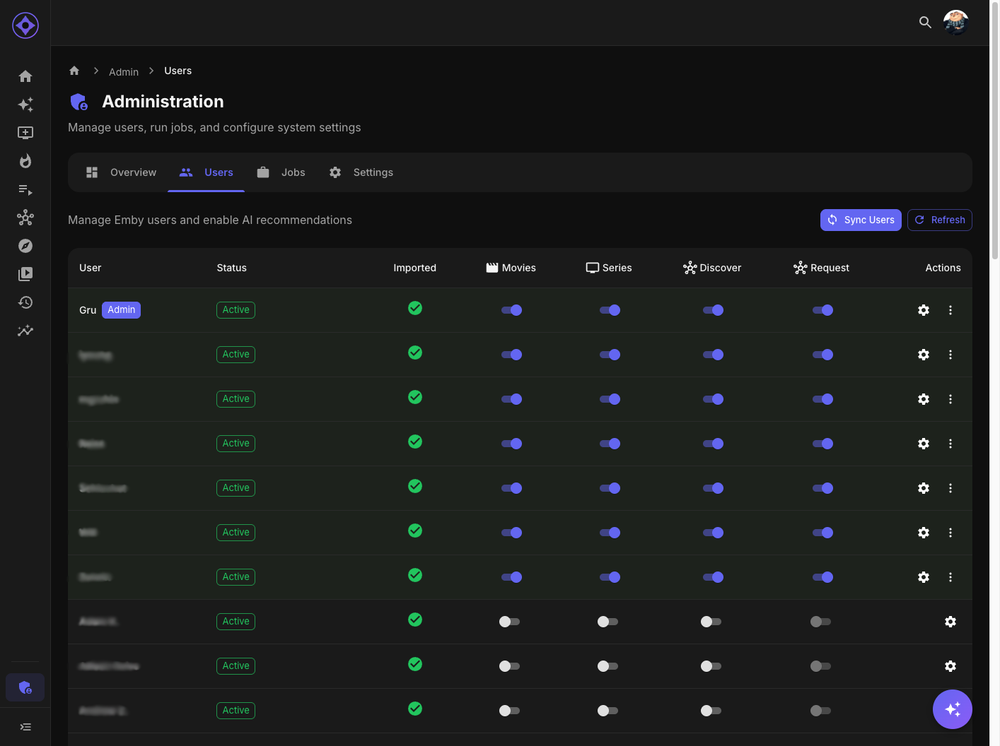

# User Management

Manage accounts, feature access, and per-user operations.

## Where It Lives

Admin console → **Access** → **Users** (`/admin/access/users`); click a row for the **user detail page** (`/admin/access/users/:id`).

## The User List

- **Sync Users** imports accounts from the media server (also automatic every 30 minutes); provider users not yet imported can be imported individually
- Per row: admin badge, quick **Movies / Series** enable toggles, and a **⌄ menu** with **"View the app as this user"** (read-only impersonation) and per-user job shortcuts — **sync history / generate recommendations / update libraries / run all**
- Sorting by email, last login, last activity

## User Detail Page

Tabs across the top:

- **Watch History** — a paginated, sortable view (recent/plays/title) of everything they've played, with play counts and favorite badges
- **Settings** — the per-user permissions and grants (see [User permissions](user-permissions.md)):
  - Movies / Series enabled
  - **Discovery suggestions** and **content requests** (disabling discovery force-disables requests)
  - **Allow creating collections** (their playlists/collections write to the server for everyone)
  - **Email notifications** opt-in (feature gated)
  - **Manage watch history** permission (lets them mark watched/unwatched)
  - **AI explanation override** permission
  - **Seerr user mapping** override

## Disabled Accounts

Disabling a user (or both media toggles) blocks login even with valid media-server credentials — the login page tells them to contact an administrator. Re-enabling restores access.

## Accounts No Longer on the Media Server

The list is built from the media server's own users, so an account deleted there has no row in it. Such accounts are listed separately under it, as **No longer on Emby** (or Jellyfin), with when they were created, when they last signed in, and how much history they hold.

- The user sync (every 30 minutes) notices them: it signs them out, stops their API keys and pauses everything done for them (recommendations, home rows, generated libraries), and keeps everything stored. Until the next sync runs the row says **Pauses at the next user sync**.
- **Remove** deletes the account for good, with its watch history, ratings, recommendations, playlists and settings, after a confirmation. It asks the media server again first and refuses if the account is still there. Nothing changes on the media server itself.
- If the account comes back on the media server, or signs in, the next sync or the sign-in lifts the pause.

The sync refuses to treat anyone as gone when the media server lists nobody, or lists none of the accounts it knows (usually a changed server address), and says so in its job log.

## Emails

Emails come from the media-server sync, **manual entry**, or the [LLDAP integration](integrations-overview.md) (`sync-lldap-emails` job).

---

**Related:** [User permissions](user-permissions.md) · [Shows You Watch configuration](shows-you-watch.md) · [Jobs overview](jobs-overview.md)
