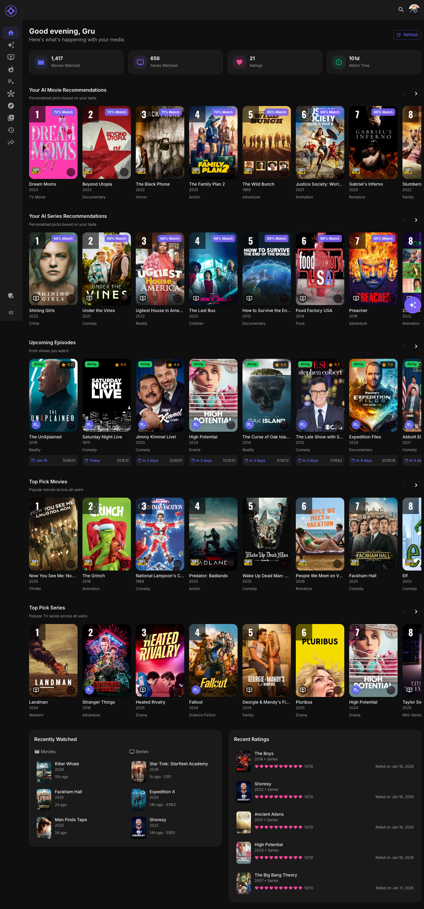

# Global Search

Search your library for movies, series, people and franchises — from a quick palette in the header, or a full search page with filters and an optional AI semantic mode.

## Two Ways to Search

### The Search Palette

Click the **search icon** in the top bar (or press **⌘K** / **Ctrl+K**):

- Results appear as you type (after two characters), in up to three sections:
  - **People** — actors and directors credited on titles you can see; opens their person page
  - **Franchises** — movie collections in your library; opens the franchise page
  - **Movies & series** — posters, title, year, and a Movie/Series chip
- **"View all results for … →"** sits right under the search box and takes you to the full search page (pressing **↵** with nothing selected does the same)
- **↑↓** to navigate, **↵** to open, **Esc** to close

Titles match by title and original title (and, more loosely, by cast, crew, keywords and synopsis). People and franchises match by **name**, where a word in the name starts with what you typed: *nol* finds Christopher Nolan, *star w* finds the Star Wars collection. Accents and apostrophes don't matter. The palette shows a few of each; for the full lists use [Browse](browse.md)'s People tab or the [Franchise Tracker](franchises.md).

### The Search Page

Open the full **Search** page for a bigger set of tools:

- **Type filter** — All / Movies / Series
- **Genre, Franchise, and Network** filters
- **Min RT Score** and **Year range** sliders
- Results as a poster grid with your ratings and watch badges

---

## AI Search

The Search page has an **AI Search** toggle (opt-in per search, requires embeddings to be enabled):

- **Off** — straight title matching: literal text in titles and original titles, with fuzzy matching for typos
- **On** — results also use **semantic matching**, so *"mind-bending sci-fi"* finds the right shelf even though no title contains those words. Matching results are marked *(with AI-powered semantic matching)*

The header palette always searches literally; switch to the full page and toggle AI Search for concept-style queries.

---

## Search Tips

| Looking for | Do this |
|-------------|---------|
| A specific title | Type it — partial titles work ("dark knight") |
| A concept or mood | Full page → **AI Search** on ("time travel romance") |
| An actor or director | Type their name — they appear under **People** in the palette (or use [Browse](browse.md) → People) |
| A franchise | Type its name — it appears under **Franchises** in the palette (or use the [Franchise Tracker](franchises.md)) |

---

## What About the AI Libraries?

The libraries Aperture generates (AI Picks, Top Picks) are marked **excluded from search** on the media server itself — so your server's own search skips them and their titles don't double up in Aperture results. Aperture's search runs against your real libraries either way.

---

**Next:** [Browse Movies & Series](browse.md)
